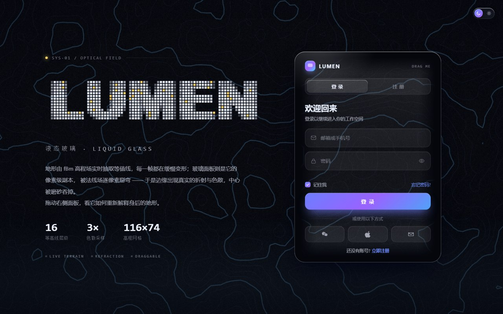
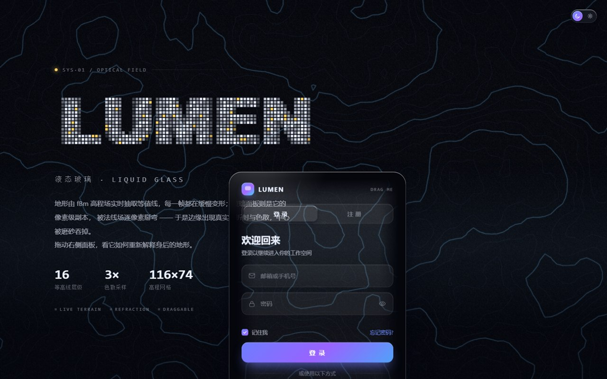
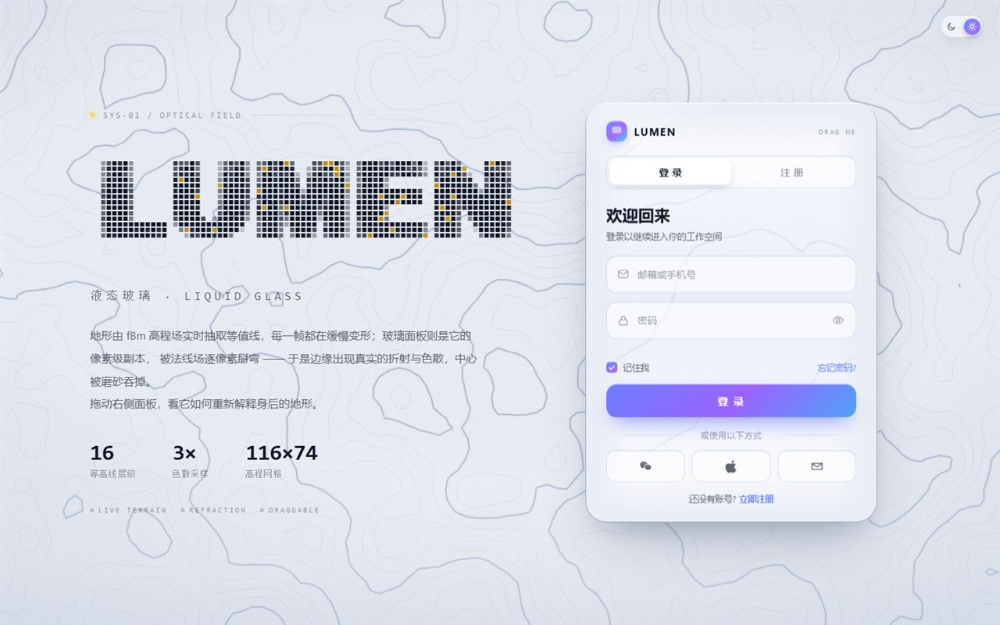
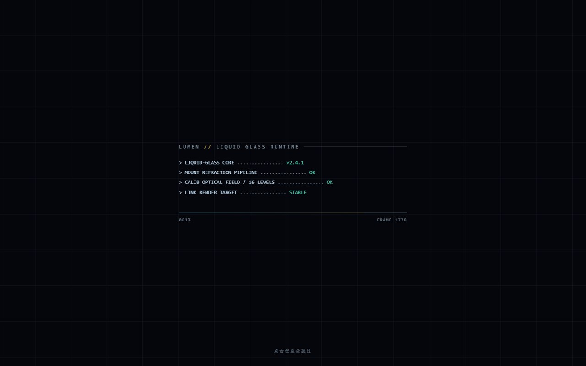

# LUMEN · 液态玻璃

一个**单文件**的液态玻璃（Liquid Glass）登录 / 注册页。没有构建步骤、没有依赖、没有框架 —— 打开 `index.html` 就是全部。

玻璃面板不是「半透明 + `backdrop-filter: blur()`」的仿制品：它是背景的**逐像素副本**，被法线场位移后重新采样。所以面板边缘会真的把身后的等高线掰弯，并且带紫青色的色散；而面板背后的地形本身还在持续流动。

## 预览

| 主界面（深色） | 面板可拖动，折射实时跟随 |
| :---: | :---: |
|  |  |

| 浅色主题 | 开场动画 |
| :---: | :---: |
|  |  |

---

## 目录

- [效果一览](#效果一览)
- [实现要点](#实现要点)
- [运行](#运行)
- [浏览器支持与降级](#浏览器支持与降级)
- [性能](#性能)
- [可调参数](#可调参数)
- [许可](#许可)

---

## 效果一览

| 能力 | 说明 |
| --- | --- |
| 边缘折射 | 基于法线贴图的位移采样，轮廓处位移为 0，因此**与背景严丝合缝、没有接缝** |
| 色散 | 三次不同强度的位移分别取 R/G/B 再合成，边缘出现真实的紫边 / 青边 |
| 等高线地形 | fBm 高程场 + Marching Squares 实时抽取等值线，每帧都在缓慢变形 |
| 方块矩阵标题 | 字形按像素采样成方块阵列，逐块飞入组装；随机横带位移 + 红青分离的故障动效 |
| 开场动画 | 扫描线 → 终端日志 → 进度条 → 收成一条水平线消失 → 标题组装、面板滑入，点击可跳过 |
| 深浅色 | View Transitions API，以开关为圆心做整页圆形渐变揭示；不支持时回退为交叉淡入 |
| 可拖动面板 | 指针捕获 + `transform`，1:1 跟手，折射层逐帧同步 |
| 无障碍 | `prefers-reduced-motion` 下关闭全部动效并跳过开场；表单具备浮动标签、校验、错误提示 |

---

## 实现要点

### 1. 边缘折射是真的，不是模糊

`backdrop-filter` 只能模糊，没法让光「拐弯」。这里的做法是：

1. 用 canvas 按面板实际尺寸算出一张**圆角矩形的有符号距离场**，把外法线方向编码进 RG 通道，得到一张法线贴图；
2. 强度曲线取 `0 → 峰值 → 0`：最外沿位移为 0（所以轮廓处和真实背景完全对齐），向内 7~20px 达到峰值再衰减 —— 这正是厚玻璃倒角的光路；
3. 用 `<feDisplacementMap>` 做三次不同 `scale` 的位移，分别抽出 R / G / B 通道，再用 `feBlend mode="screen"` 合回去，得到色散；
4. 背景副本画在一张 `<canvas>` 上，按视口偏移裁切后交给上面的滤镜。因为引用的是**活的 canvas 位图**而不是 `feImage` 里的图片，所以它逐帧刷新，能跟着动态背景走。

> 踩过的坑：`backdrop-filter: url(#filter)` 里用 `feImage` 在 Chromium 下不生效；而 `feImage` 引用 data URI 时，如果滤镜区域不是 `0/0/100%/100%`、`feImage` 尺寸又与元素不等，贴图会被拉伸，面板内只剩法线图的灰色中心（= 完全不位移）。

### 2. 等高线地形

值噪声叠 5 个倍频得到高程场，再对 16 个层级跑 Marching Squares 抽出等值线，每 4 层加粗为「计曲线」并带一层辉光，最后叠颗粒。

让它「活起来」的关键：每个倍频以**不同速度与方向**在噪声空间漂移，于是地形是**变形**而不是整体平移，再加一个缓慢的缩放呼吸。

实测一次重建约 **2.3ms**，所以直接隔帧重算，开销可接受。

### 3. 方块矩阵标题

把字形缩到 `列数 × 行数` 采样（一个像素 = 一个方块），用抗锯齿的覆盖率当作方块强度：

- **组装**：每块从随机偏移飞入，按横向错峰，`easeOutCubic`；
- **常态**：逐块正弦闪烁，一条扫描线扫过时提亮，少量方块是琥珀色高亮；
- **故障**：随机挑 1~3 条横带整行位移，位移带上的方块画成红 / 青分离，持续 70~220ms。

### 4. 深浅色

两套主题各烘焙一张等高线画布，切换时两层交叉淡入 —— 配合 View Transitions 的整页快照，用 `clip-path: circle()` 从开关位置扩散，就是那种「整页渐变揭示」的效果。

代价是背景层的采样要跟着改：等高线画布带 `translate + scale`，所以折射副本的逻辑是**逆变换**（`k = dpr / sc`）而不是简单的整数偏移。

### 5. 拖动面板

`pointerdown` + `setPointerCapture` 记录起点，`pointermove` 直接写 `transform`。

> 踩过的坑：卡片上原本有 `transition: transform 1s` 用于入场，结果每次拖动都被 CSS 过渡拉成一秒，表现就是「慢半拍地追鼠标」。现在入场位移改由 JS 缓动，拖动路径上不存在任何过渡。

带动画背景时还有个连带问题：面板里的折射副本必须用**与背景相同的偏移**去裁切，而这个偏移要算上拖动位移。所以每帧都用 `元素未变换时的位置 + 当前位移` 重新计算采样原点。

---

## 运行

无需任何构建工具：

```bash
git clone https://github.com/BLxieFox/lumen-liquid-glass.git
cd lumen-liquid-glass
# 直接用浏览器打开 index.html
```

或者起一个静态服务器（可选）：

```bash
python -m http.server 8000
# 然后访问 http://localhost:8000
```

> 用 `file://` 打开即可，没有任何跨域或网络请求。

---

## 浏览器支持与降级

主力目标是最新 Chromium（Chrome / Edge）。

| 特性 | 不可用时的表现 |
| --- | --- |
| SVG 滤镜（`feDisplacementMap`） | 退化为「对齐副本 + 磨砂」，观感依旧成立，只是没有边缘弯折 |
| `backdrop-filter` | 退化为半透明色块 |
| View Transitions API | 回退为「背景双层交叉淡入 + CSS 颜色过渡」的整页渐变 |
| `prefers-reduced-motion` | 跳过开场动画，关闭地形漂移、方块闪烁与故障 |

---

## 性能

自带两级自适应降级：预热 24 帧后统计平均帧时，超过 26ms 时先关闭边缘色散（三次位移降为一次），仍然吃力则把内部署分辨率降到 1.0 并把地形重建降到每 3 帧一次。

实测数据（1440×900，无 GPU 的软件光栅环境）：

| 项目 | 耗时 |
| --- | --- |
| 等高线层重建（1624×1084 @1.5x） | ~2.3 ms |
| 地形重建频率 | 每 2 帧 |

---

## 可调参数

| 变量 | 位置 | 作用 |
| --- | --- | --- |
| `--bleed` | `:root` | 折射层向外溢出的像素，决定滤镜能采样到多远的背景 |
| `--card-w` / `--card-h` / `--card-r` | `:root` | 面板尺寸与圆角（法线贴图会按实际尺寸重新生成） |
| `--left-shift` | `.left` | 左栏整体右移量 |
| `--title-x` | `.title` | 方块标题的额外横向微调 |
| `chromatic(96)` | `build()` | 边缘色散强度 |
| `LEVELS` / `GW` / `GH` | `paintLayer()` | 等高线层级数与高程网格分辨率 |
| `BG.tilt` / `BG.zc` / `BG.focal` | `BG` | 地形视角（倾斜角 / 中心深度 / 焦距） |

---

## 许可

[MIT](LICENSE) © 2026 BLxieFox
